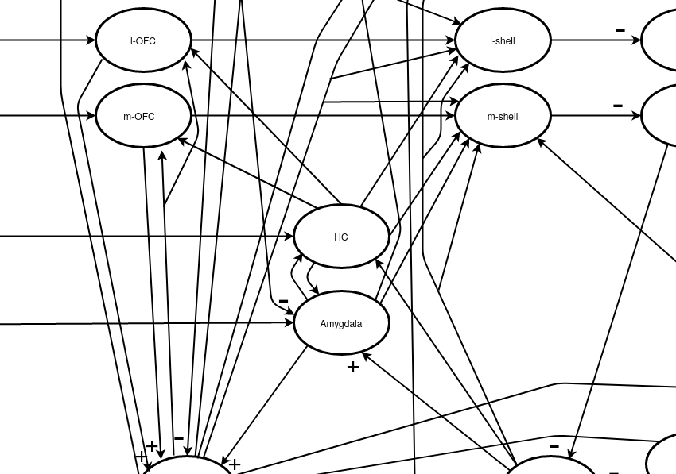

# Limbic-system map

[DOI:10.5281/zenodo.3740761](https://doi.org/10.5281/zenodo.3740761)

This is the underlying repository which documents the limbic system
predominantly of the rat. 

## Document-formats and software used

Both the map and the text have open data formats and have been
created with open source software.

### draw.io

The brain map `limbic-map.xml` has been drawn with
`draw.io`: https://app.diagrams.net/

### LaTeX

The document is written in LaTex with bibtex entries. The brain map embedded
in the LaTeX document is a PDF export from `draw.io`.

### Creating the documents

 - Open `limbic-map.xml` with draw.io and save the map as `limbic-map.pdf`.
 - Just run `make` which (re-) generates the PDF.

# Maintainer

Bernd Porr <Bernd.porr@glasgow.ac.uk>, mail@berndporr.me.uk
